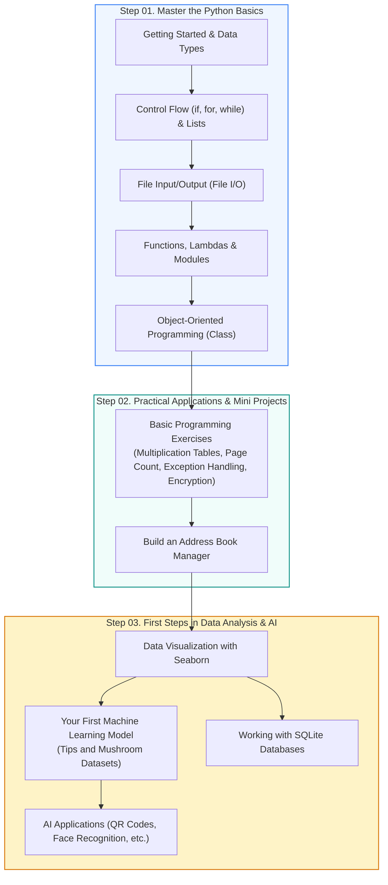

🇰🇷 [한국어](README.md) · 🇺🇸 **English** · 🇯🇵 [日本語](README.ja.md)

# 🐍 Python Programming Fundamentals (CLASS_PYTHON_START)

<p align="center">
  <a href="https://ldjwj.github.io/CLASS_PYTHON_START/README.en.html">
    
  </a>
  
  
  
  
</p>

> **Your first steps into Python programming — easy for anyone to start!**  
> Step-by-step practice code that takes you from core Python syntax (variables, control flow, functions, classes) to practical applications (an address book, mini projects) and a first taste of data analysis and AI.  
> ⭐️ If this helped your learning, please give it a **Star** using the button at the top right!

> **Note:** All slides and notebooks (PDF/HTML) are in Korean. The code itself is language-independent, and your browser's built-in translation (e.g. Chrome) works on the HTML pages.

<p align="center">
  <a href="#️-learning-roadmap">🗺️ Learning Roadmap</a> •
  <a href="#-python-basics-practice">📘 Basic Syntax</a> •
  <a href="#-practical-python-applications--projects">💡 Practical Applications</a> •
  <a href="#-a-taste-of-data-science--machine-learning">📊 A Taste of Data & AI</a> •
  <a href="#️-development-environment-setup-guide">🛠️ Environment Setup</a>
</p>

---

## 🗺️ Learning Roadmap



---

## 📘 Python Basics Practice

Every practice notebook runs in **Google Colab**, right in your browser with a single click.

| Step | Topic | Key Content | One-Click Colab |
|:---:|:---|:---|:---:|
| **1-1** | **Getting Started with Python** | Variables, data types (numbers, strings), basic I/O with `print()` and `input()` | [](https://colab.research.google.com/github/LDJWJ/CLASS_PYTHON_START/blob/main/01_01_python_start.ipynb) |
| **1-2** | **Conditionals, Loops & Lists** | `if-else` branching, `for`/`while` loops, working with lists and dictionaries | [](https://colab.research.google.com/github/LDJWJ/CLASS_PYTHON_START/blob/main/01_02_python_start_if_for_list.ipynb) |
| **1-3** | **File Input/Output** | Reading and writing text files (`open`, `with`, `readline`, `write`) | [](https://colab.research.google.com/github/LDJWJ/CLASS_PYTHON_START/blob/main/01_03_python_start_file.ipynb) |
| **1-4** | **Functions and Modules** | User-defined functions with `def`, parameters and return values, importing standard modules with `import` | [](https://colab.research.google.com/github/LDJWJ/CLASS_PYTHON_START/blob/main/01_04_python_start_fnc_module.ipynb) |
| **1-5** | **Introduction to Classes** | Classes and objects, the `__init__` constructor, attributes and methods | [](https://colab.research.google.com/github/LDJWJ/CLASS_PYTHON_START/blob/main/01_04_class_start_typeA.ipynb) |
| **1-5** | **Advanced Classes & Inheritance** | Class inheritance, overriding, encapsulation in object-oriented programming | [](https://colab.research.google.com/github/LDJWJ/CLASS_PYTHON_START/blob/main/01_04_class_start_typeB.ipynb) |

---

## 💡 Practical Python Applications & Projects

In this hands-on part, you put the theory to work by building programs that actually run.

| Chapter | Topic | Main Content | Materials & Practice Links |
|:---:|:---|:---|:---:|
| **2-1** | **Basic Programming in Practice** | Printing multiplication tables, calculating the total number of pages on a message board, error/exception handling (`try-except`), string encryption | [📄 PDF](https://ldjwj.github.io/CLASS_PYTHON_START/02_01_programming_2204.pdf) · [🌐 HTML](https://ldjwj.github.io/CLASS_PYTHON_START/02_01_programming_220413.html) · [](https://colab.research.google.com/github/LDJWJ/CLASS_PYTHON_START/blob/main/02_01_programming.ipynb) |
| **2-2** | **Address Book Manager** | A console application to add, search, update, and delete (CRUD) contacts | [📄 PDF](https://ldjwj.github.io/CLASS_PYTHON_START/02_02_python_start_contact_2204.pdf) · [💻 Source Code](02_02_programming_contact.py) |

---

## 📊 A Taste of Data Science & Machine Learning

A guide to branching out naturally into data analysis and artificial intelligence once you are comfortable with Python syntax.

```
┌────────────────────────┐      ┌────────────────────────┐      ┌────────────────────────┐
│  📈 Data Visualization │ ---> │  🤖 ML Modeling        │ ---> │  💾 Database Access    │
│  - Seaborn basic charts│      │  - Tips regression     │      │  - Connect to SQLite3  │
│  - Plot distributions  │      │  - Mushroom toxicity   │      │  - Create/query tables │
└────────────────────────┘      └────────────────────────┘      └────────────────────────┘
```

* **📈 Data Visualization (Seaborn)**:
  * [📄 PDF Textbook](https://ldjwj.github.io/CLASS_PYTHON_START/03_01_Seaborn_Basic.pdf) · [🌐 HTML Viewer](https://ldjwj.github.io/CLASS_PYTHON_START/03_01_Seaborn_Basic.html)
* **🤖 Building Machine Learning Models (Scikit-Learn)**:
  * Random forest for predicting tips (Tips dataset): [](https://colab.research.google.com/github/LDJWJ/CLASS_PYTHON_START/blob/main/ch02_03_03_RandomForest_01_Tips_01.ipynb)
  * Your first model: classifying mushroom toxicity (Mushroom dataset): [](https://colab.research.google.com/github/LDJWJ/CLASS_PYTHON_START/blob/main/03_02_ml_start.ipynb)
* **💾 Working with SQLite Databases**:
  * Connecting Python to an SQLite3 database and running queries: [](https://colab.research.google.com/github/LDJWJ/CLASS_PYTHON_START/blob/main/03_03_DB.ipynb)
* **🎨 More Ways to Use Python**:
  * An automatic QR code generator
  * A taste of AI drawing & face recognition programs

---

## 🛠️ Development Environment Setup Guide

Detailed manuals for setting up a practice environment on your local PC (Windows).

* **Anaconda Installation Guide**:
  * [📄 Anaconda Installation PDF](https://ldjwj.github.io/kagglebook/pdf_html/env01_anaconda_install_V11_2508.pdf)
* **Installing Visual Studio Code (VS Code) and Setting Up the Python Extension**:
  * [📄 VS Code Installation PDF (1)](https://ldjwj.github.io/CLASS_PYTHON_START/03_[Window]01_visual_studio_code설치.pdf) · [🌐 HTML (1)](https://ldjwj.github.io/CLASS_PYTHON_START/03_[Window]01_visual_studio_code설치.html)
  * [📄 VS Code Installation PDF (2)](https://ldjwj.github.io/CLASS_PYTHON_START/03_[Window]02_visual_studio_code설치(2).pdf) · [🌐 HTML (2)](https://ldjwj.github.io/CLASS_PYTHON_START/03_[Window]02_visual_studio_code설치(2).html)

---

## 🔗 License & Contact

* **Contact**: For copyright inquiries and partnerships: [frontier1020@naver.com](mailto:frontier1020@naver.com)
* **License**: All materials in this repository are licensed under [CC BY-NC 4.0](LICENSE). You are free to use them for non-commercial purposes as long as you give appropriate credit.
