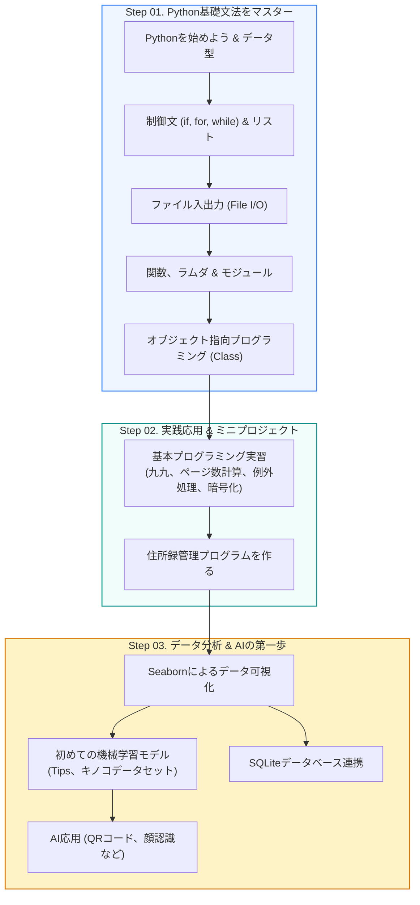

🇰🇷 [한국어](README.md) · 🇺🇸 [English](README.en.md) · 🇯🇵 **日本語**

# 🐍 Pythonプログラミング基礎 (CLASS_PYTHON_START)

<p align="center">
  <a href="https://ldjwj.github.io/CLASS_PYTHON_START/README.ja.html">
    
  </a>
  
  
  
  
</p>

> **誰でも気軽に始められる、Pythonプログラミングの第一歩！**  
> Pythonの基本文法（変数、制御文、関数、クラス）から実践的な応用（住所録、ミニプロジェクト）、さらにデータ分析・AIの入門まで、段階的な実習コードを提供します。  
> ⭐️ 学習のお役に立てたなら、右上の **Star** ボタンをぜひ押してください！

> **ご注意：** 教材（PDF/HTML）はすべて **韓国語** で書かれています。コードはそのまま実行でき、HTMLページはブラウザ（Chromeなど）の自動翻訳で読むことができます。

<p align="center">
  <a href="#️-学習ロードマップ">🗺️ 学習ロードマップ</a> •
  <a href="#-python基礎文法の実習">📘 基礎文法</a> •
  <a href="#-python実践応用--プロジェクト">💡 実践応用</a> •
  <a href="#-データサイエンス--機械学習のお試し">📊 データ & AI入門</a> •
  <a href="#️-開発環境セットアップガイド">🛠️ 環境設定</a>
</p>

---

## 🗺️ 学習ロードマップ



---

## 📘 Python基礎文法の実習

すべての実習コードは、ブラウザからワンクリックで実行できる **Google Colab** 環境に対応しています。

| ステップ | 学習テーマ | 主な内容 | Colabでワンクリック実習 |
|:---:|:---|:---|:---:|
| **1-1** | **Pythonを始めよう** | 変数、データ型（数値、文字列）、基本的な入出力 `print()`、`input()` | [](https://colab.research.google.com/github/LDJWJ/CLASS_PYTHON_START/blob/main/01_01_python_start.ipynb) |
| **1-2** | **条件文 & 繰り返し文 & リスト** | `if-else` による分岐、`for`/`while` による繰り返し、リストと辞書の操作 | [](https://colab.research.google.com/github/LDJWJ/CLASS_PYTHON_START/blob/main/01_02_python_start_if_for_list.ipynb) |
| **1-3** | **ファイル入出力を学ぶ** | テキストファイルの読み書き（`open`、`with`、`readline`、`write`） | [](https://colab.research.google.com/github/LDJWJ/CLASS_PYTHON_START/blob/main/01_03_python_start_file.ipynb) |
| **1-4** | **関数とモジュール** | ユーザー定義関数 `def`、引数と戻り値、標準モジュールの `import` | [](https://colab.research.google.com/github/LDJWJ/CLASS_PYTHON_START/blob/main/01_04_python_start_fnc_module.ipynb) |
| **1-5** | **クラス（Class）入門** | クラスとオブジェクトの概念、`__init__` コンストラクタ、属性とメソッド | [](https://colab.research.google.com/github/LDJWJ/CLASS_PYTHON_START/blob/main/01_04_class_start_typeA.ipynb) |
| **1-5** | **クラスの応用 & 継承** | クラスの継承、オーバーライド、オブジェクト指向のカプセル化 | [](https://colab.research.google.com/github/LDJWJ/CLASS_PYTHON_START/blob/main/01_04_class_start_typeB.ipynb) |

---

## 💡 Python実践応用 & プロジェクト

学んだ理論をもとに、実際に動くプログラムを作ってみる実践パートです。

| チャプター | テーマ | 主な内容 | 教材・実習リンク |
|:---:|:---|:---|:---:|
| **2-1** | **基本的なプログラミング活用** | 九九の出力、掲示板の総ページ数の計算、エラー・例外処理（`try-except`）、文字列の暗号化 | [📄 PDF](https://ldjwj.github.io/CLASS_PYTHON_START/02_01_programming_2204.pdf) · [🌐 HTML](https://ldjwj.github.io/CLASS_PYTHON_START/02_01_programming_220413.html) · [](https://colab.research.google.com/github/LDJWJ/CLASS_PYTHON_START/blob/main/02_01_programming.ipynb) |
| **2-2** | **住所録管理プログラム** | ユーザーの登録・検索・修正・削除（CRUD）を行うコンソールアプリケーション | [📄 PDF](https://ldjwj.github.io/CLASS_PYTHON_START/02_02_python_start_contact_2204.pdf) · [💻 ソースコード](02_02_programming_contact.py) |

---

## 📊 データサイエンス & 機械学習のお試し

Pythonの文法を身につけた後、データ分析や人工知能の分野へ自然にステップアップするためのガイドです。

```
┌────────────────────────┐      ┌────────────────────────┐      ┌────────────────────────┐
│  📈 データ可視化        │ ---> │  🤖 機械学習モデリング  │ ---> │  💾 データベース連携    │
│  - Seaborn 基本チャート │      │  - Tips チップ予測回帰  │      │  - SQLite3 DB 接続      │
│  - データ分布の可視化   │      │  - キノコ毒性の分類予測 │      │  - テーブル作成/照会    │
└────────────────────────┘      └────────────────────────┘      └────────────────────────┘
```

* **📈 データ可視化 (Seaborn)**:
  * [📄 PDF教材](https://ldjwj.github.io/CLASS_PYTHON_START/03_01_Seaborn_Basic.pdf) · [🌐 HTMLビューア](https://ldjwj.github.io/CLASS_PYTHON_START/03_01_Seaborn_Basic.html)
* **🤖 機械学習モデルを作る (Scikit-Learn)**:
  * Tipsデータでチップを予測するランダムフォレスト: [](https://colab.research.google.com/github/LDJWJ/CLASS_PYTHON_START/blob/main/ch02_03_03_RandomForest_01_Tips_01.ipynb)
  * キノコ（Mushroom）の毒性を分類する初めてのモデル: [](https://colab.research.google.com/github/LDJWJ/CLASS_PYTHON_START/blob/main/03_02_ml_start.ipynb)
* **💾 SQLiteデータベース連携**:
  * PythonとSQLite3データベースの接続およびクエリの実行: [](https://colab.research.google.com/github/LDJWJ/CLASS_PYTHON_START/blob/main/03_03_DB.ipynb)
* **🎨 さまざまなPythonの活用**:
  * QRコード自動生成プログラム
  * AIお絵描き & 顔認識プログラムの体験

---

## 🛠️ 開発環境セットアップガイド

ローカルPC（Windows）で実習環境を構築するための詳細マニュアルです。

* **Anaconda（アナコンダ）インストールガイド**:
  * [📄 Anacondaインストール PDF](https://ldjwj.github.io/kagglebook/pdf_html/env01_anaconda_install_V11_2508.pdf)
* **Visual Studio Code（VS Code）のインストールとPython拡張機能の設定**:
  * [📄 VS Codeインストール PDF (1)](https://ldjwj.github.io/CLASS_PYTHON_START/03_[Window]01_visual_studio_code설치.pdf) · [🌐 HTML (1)](https://ldjwj.github.io/CLASS_PYTHON_START/03_[Window]01_visual_studio_code설치.html)
  * [📄 VS Codeインストール PDF (2)](https://ldjwj.github.io/CLASS_PYTHON_START/03_[Window]02_visual_studio_code설치(2).pdf) · [🌐 HTML (2)](https://ldjwj.github.io/CLASS_PYTHON_START/03_[Window]02_visual_studio_code설치(2).html)

---

## 🔗 ライセンスとお問い合わせ

* **お問い合わせ**: 著作権に関するお問い合わせ・その他の提携: [frontier1020@naver.com](mailto:frontier1020@naver.com)
* **ライセンス**: 本リポジトリのすべての資料は [CC BY-NC 4.0](LICENSE) ライセンスに従います。出典を明記すれば、非営利目的で自由にご利用いただけます。
