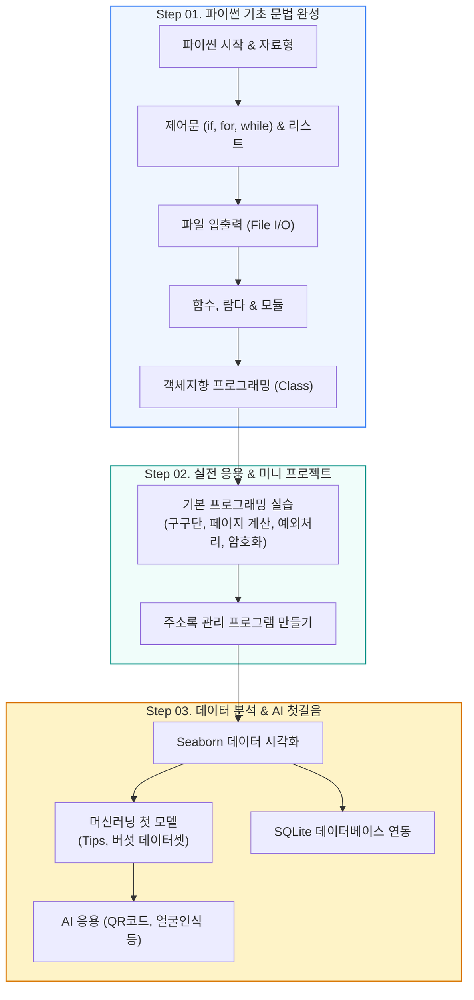

🇰🇷 **한국어** · 🇺🇸 [English](README.en.md) · 🇯🇵 [日本語](README.ja.md)

# 🐍 파이썬 기초 프로그래밍 (CLASS_PYTHON_START)

<p align="center">
  <a href="https://ldjwj.github.io/CLASS_PYTHON_START/">
    
  </a>
  
  
  
  
</p>

> **누구나 쉽게 시작하는 파이썬 프로그래밍 첫걸음!**  
> 파이썬 기본 문법(변수, 제어문, 함수, 클래스)부터 실전 응용(주소록, 미니 프로젝트) 및 데이터 분석·AI 맛보기까지 단계별 실습 코드를 제공합니다.  
> ⭐️ 학습에 도움이 되셨다면 우측 상단의 **Star** 버튼을 꾹 눌러주세요!

<p align="center">
  <a href="#️-학습-로드맵">🗺️ 학습 로드맵</a> •
  <a href="#-파이썬-기초-문법-실습">📘 기초 문법</a> •
  <a href="#-파이썬-실전-응용--프로젝트">💡 실전 응용</a> •
  <a href="#-데이터-과학--머신러닝-맛보기">📊 데이터 & AI 맛보기</a> •
  <a href="#️-개발-환경-설정-가이드">🛠️ 환경 설정</a>
</p>

---

## 🗺️ 학습 로드맵



---

## 📘 파이썬 기초 문법 실습

모든 실습 코드는 브라우저에서 클릭 한 번으로 실행 가능한 **Google Colab** 환경을 지원합니다.

| 단계 | 학습 주제 | 핵심 내용 | Colab 원클릭 실습 |
|:---:|:---|:---|:---:|
| **1-1** | **Python 시작하기** | 변수, 자료형(숫자, 문자열), 기본 입출력 `print()`, `input()` | [](https://colab.research.google.com/github/LDJWJ/CLASS_PYTHON_START/blob/main/01_01_python_start.ipynb) |
| **1-2** | **조건문 & 반복문 & 리스트** | `if-else` 분기문, `for`/`while` 반복문, 리스트와 딕셔너리 조작 | [](https://colab.research.google.com/github/LDJWJ/CLASS_PYTHON_START/blob/main/01_02_python_start_if_for_list.ipynb) |
| **1-3** | **파일 입출력 알아보기** | 텍스트 파일 읽기/쓰기 (`open`, `with`, `readline`, `write`) | [](https://colab.research.google.com/github/LDJWJ/CLASS_PYTHON_START/blob/main/01_03_python_start_file.ipynb) |
| **1-4** | **함수와 모듈** | 사용자 정의 함수 `def`, 매개변수와 반환값, 표준 모듈 `import` | [](https://colab.research.google.com/github/LDJWJ/CLASS_PYTHON_START/blob/main/01_04_python_start_fnc_module.ipynb) |
| **1-5** | **클래스(Class) 입문** | 클래스와 객체 개념, `__init__` 생성자, 속성과 메서드 | [](https://colab.research.google.com/github/LDJWJ/CLASS_PYTHON_START/blob/main/01_04_class_start_typeA.ipynb) |
| **1-5** | **클래스 심화 & 상속** | 클래스 상속, 오버라이딩, 객체지향 캡슐화 | [](https://colab.research.google.com/github/LDJWJ/CLASS_PYTHON_START/blob/main/01_04_class_start_typeB.ipynb) |

---

## 💡 파이썬 실전 응용 & 프로젝트

이론을 바탕으로 실제 동작하는 프로그램을 만들어보는 실전 파트입니다.

| 챕터 | 주제 | 주요 내용 | 교재 및 실습 링크 |
|:---:|:---|:---|:---:|
| **2-1** | **기본 활용 프로그래밍** | 구구단 출력, 게시판 총 페이지 수 계산, 에러/예외 처리(`try-except`), 문자열 암호화 | [📄 PDF](https://ldjwj.github.io/CLASS_PYTHON_START/02_01_programming_2204.pdf) · [🌐 HTML](https://ldjwj.github.io/CLASS_PYTHON_START/02_01_programming_220413.html) · [](https://colab.research.google.com/github/LDJWJ/CLASS_PYTHON_START/blob/main/02_01_programming.ipynb) |
| **2-2** | **주소록 관리 프로그램** | 사용자 등록/검색/수정/삭제(CRUD) 콘솔 애플리케이션 | [📄 PDF](https://ldjwj.github.io/CLASS_PYTHON_START/02_02_python_start_contact_2204.pdf) · [💻 소스코드](02_02_programming_contact.py) |

---

## 📊 데이터 과학 & 머신러닝 맛보기

파이썬 문법을 익힌 후 데이터 분석과 인공지능 분야로 자연스럽게 확장할 수 있는 가이드입니다.

```
┌────────────────────────┐      ┌────────────────────────┐      ┌────────────────────────┐
│  📈 데이터 시각화       │ ---> │  🤖 머신러닝 모델링     │ ---> │  💾 데이터베이스 연동   │
│  - Seaborn 기본 차트    │      │  - Tips 팁 예측 회귀   │      │  - SQLite3 DB 접속     │
│  - 데이터 분포 시각화    │      │  - 버섯 독성 분류 예측 │      │  - 테이블 생성/조회    │
└────────────────────────┘      └────────────────────────┘      └────────────────────────┘
```

* **📈 데이터 시각화 (Seaborn)**:
  * [📄 PDF 교재](https://ldjwj.github.io/CLASS_PYTHON_START/03_01_Seaborn_Basic.pdf) · [🌐 HTML 뷰어](https://ldjwj.github.io/CLASS_PYTHON_START/03_01_Seaborn_Basic.html)
* **🤖 머신러닝 모델 만들기 (Scikit-Learn)**:
  * Tips 팁 예측 랜덤포레스트: [](https://colab.research.google.com/github/LDJWJ/CLASS_PYTHON_START/blob/main/ch02_03_03_RandomForest_01_Tips_01.ipynb)
  * 버섯(Mushroom) 독성 분류 첫 모델: [](https://colab.research.google.com/github/LDJWJ/CLASS_PYTHON_START/blob/main/03_02_ml_start.ipynb)
* **💾 SQLite 데이터베이스 연동**:
  * 파이썬과 SQLite3 데이터베이스 연결 및 쿼리 실행: [](https://colab.research.google.com/github/LDJWJ/CLASS_PYTHON_START/blob/main/03_03_DB.ipynb)
* **🎨 다양한 파이썬 활용**:
  * QR 코드 자동 생성 프로그램
  * 인공지능 그림 그리기 & 얼굴 인식 프로그램 맛보기

---

## 🛠️ 개발 환경 설정 가이드

로컬 PC(Windows)에서 실습 환경을 구축할 수 있는 상세 매뉴얼입니다.

* **Anaconda(아나콘다) 설치 가이드**:
  * [📄 Anaconda 설치 PDF](https://ldjwj.github.io/kagglebook/pdf_html/env01_anaconda_install_V11_2508.pdf)
* **Visual Studio Code(VS Code) 설치 및 파이썬 확장팩 설정**:
  * [📄 VS Code 설치 PDF (1)](https://ldjwj.github.io/CLASS_PYTHON_START/03_[Window]01_visual_studio_code설치.pdf) · [🌐 HTML (1)](https://ldjwj.github.io/CLASS_PYTHON_START/03_[Window]01_visual_studio_code설치.html)
  * [📄 VS Code 설치 PDF (2)](https://ldjwj.github.io/CLASS_PYTHON_START/03_[Window]02_visual_studio_code설치(2).pdf) · [🌐 HTML (2)](https://ldjwj.github.io/CLASS_PYTHON_START/03_[Window]02_visual_studio_code설치(2).html)

---

## 🔗 라이선스 및 문의

* **문의 사항**: 저작권 문의 및 기타 제휴: [frontier1020@naver.com](mailto:frontier1020@naver.com)
* **라이선스**: 본 저장소의 모든 자료는 [CC BY-NC 4.0](LICENSE) 라이선스를 따릅니다. 출처를 표시하면 비영리 목적으로 자유롭게 활용하실 수 있습니다.
